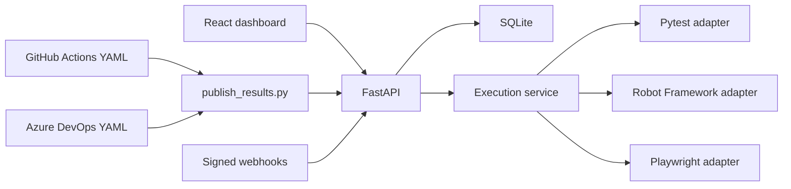

# CI/CD Test Automation Platform

A local control plane for organizing test pipelines, running an approved catalog of Pytest, Robot Framework, and Playwright suites, and reporting the results. The API, dashboard, and sample pipelines run without a paid CI service. GitHub Actions and Azure DevOps are optional readers of remote metadata, and the YAML in `pipelines/` is ready to copy into another repository.

## What it does

- Registers projects, environments, and pipeline configuration.
- Starts a run only for a suite in the approved catalog. The public API has no command, script, or filesystem field.
- Tracks queued, running, passed, failed, error, and cancelled executions.
- Stores each test result, duration, and failure message.
- Aggregates pass rate, average duration, project stats, and repeated failures from the database.
- Accepts signed GitHub and Azure-style webhooks and ingested JUnit results from external jobs.
- Exports JSON, CSV, HTML, and Markdown reports.
- Ships seven GitHub Actions workflows and seven Azure DevOps pipelines for Pytest, Robot Framework, Playwright, smoke, regression, pull requests, and scheduled runs.

Demo history is seeded on an empty database and labeled `demo seed` in the API and dashboard. Uncheck **Include demo seed** to hide it. A run started from Pipelines is stored as a live execution.

## Architecture



The execution service builds a fixed argument list for `python -m pytest`, `python -m robot`, or `python -m app.services.playwright_suite`. `shell` is false. The child environment keeps path and locale variables and drops API keys, webhook secrets, and provider tokens.

## Local startup

```bash
python3 -m venv .venv
source .venv/bin/activate
python -m pip install -r backend/requirements.txt -r backend/requirements-dev.txt
uvicorn app.main:app --app-dir backend --host 127.0.0.1 --port 8000
```

In another shell:

```bash
cd frontend
npm install
npm run dev
```

Open http://127.0.0.1:5173. The Vite server proxies `/api` and `/health` to port 8000. The local operator key is `local-operator-key`. The read-only key is `local-viewer-key`. Both are development placeholders in `.env.example`.

Docker Compose is documented in [docs/setup.md](docs/setup.md). Playwright browser binaries are optional and are not part of the default image. See [docs/security.md](docs/security.md) for the trust boundary.

## Quality gates

```bash
source .venv/bin/activate
ruff check backend scripts
bandit -c pyproject.toml -r backend/app -q
python scripts/scan_secrets.py
python scripts/validate_templates.py
python scripts/validate_docker.py
python scripts/validate_docs.py
pytest --junitxml=reports/junit-backend.xml
cd frontend && npm test && npm run lint && npm run build
```

Measured results from the implementation machine are in [docs/execution-evidence.md](docs/execution-evidence.md).

## Layout

| Path | Purpose |
| --- | --- |
| `backend/app` | API, persistence, execution, reporting |
| `sample-suites` | The only directories the runner is allowed to execute |
| `pipelines/github` and `pipelines/azure` | Template library |
| `pipelines/scripts/publish_results.py` | Stdlib client that posts JUnit to an ingest execution |
| `frontend` | Dashboard |
| `.github/workflows/ci.yml` | Lint, tests, build, secret scan, dependency audit |

## Further reading

- [Setup](docs/setup.md)
- [Architecture](docs/architecture.md)
- [Pipeline integration](docs/pipeline-integration.md)
- [API](docs/api.md)
- [Security](docs/security.md)
- [Upwork case study](docs/portfolio/upwork-case-study.md)
