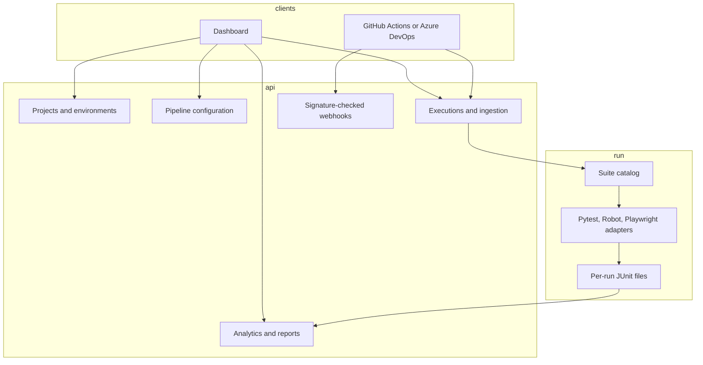

# Architecture

The platform is a single FastAPI process and a React dashboard. SQLite is the system of record. Analytics endpoints read that database. The dashboard does not invent counts.

## Execution lifecycle

1. An operator creates an execution for an enabled pipeline, or a signed webhook matches a pipeline by provider, repository URL, classification, and branch pattern.
2. The row is stored as `queued`, then `running`.
3. `run_mode=local` starts one approved adapter. `run_mode=ingest` waits for `POST /api/executions/{id}/results`.
4. JUnit is parsed into `test_results`. The execution becomes `passed`, `failed`, or `error`.
5. A log notification is stored. A webhook notification is sent only when `NOTIFY_WEBHOOK_URL` is set. The stored summary never includes the API key.
6. Cancel is accepted while the row is queued or running. A later ingest is rejected.

## Catalog

| Suite id | Adapter | What runs |
| --- | --- | --- |
| `checkout-pytest` | pytest | Passing checkout tests with `smoke` and `regression` markers |
| `checkout-failures` | pytest | One intentional failing assertion |
| `billing-robot` | robot | Invoice cases tagged `smoke` or `regression` |
| `portal-playwright` | playwright | Declarative scenarios against a local HTML fixture |

Adding a suite means adding a catalog entry and files under `sample-suites/` in a reviewed change. The API cannot register a path.

## Classification

| Classification | Local selection | Typical provider use |
| --- | --- | --- |
| `smoke` | marker or tag `smoke` | Fast push checks |
| `regression` | marker or tag `regression` | Broader pre-release runs |
| `pr_validation` | same selection as smoke | Pull request webhooks |
| `scheduled` | the whole suite | Weekday schedules and ingest |

## Providers

Without tokens, GitHub and Azure endpoints report that remote listing is not configured and the template library is still served. With `GITHUB_TOKEN` plus `GITHUB_REPOSITORY`, or `AZURE_ORG`, `AZURE_PROJECT`, and `AZURE_PAT`, the status endpoint counts remote workflows or pipelines. Tokens are read from the environment and are not returned or logged.
